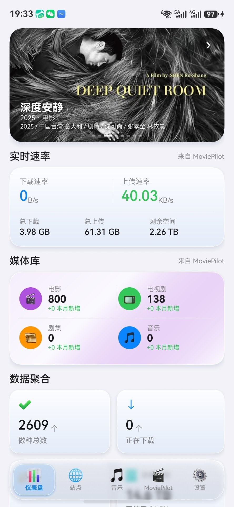
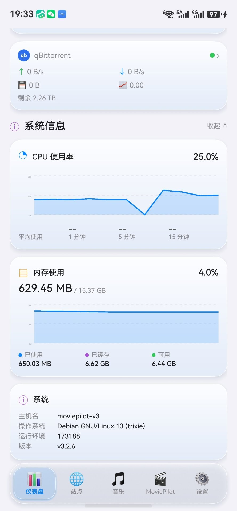
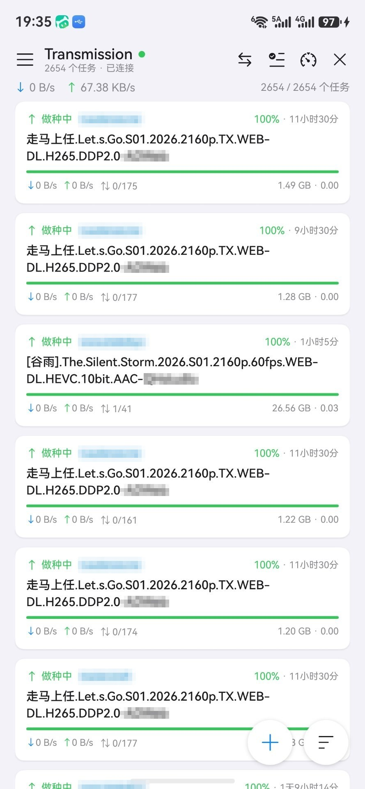
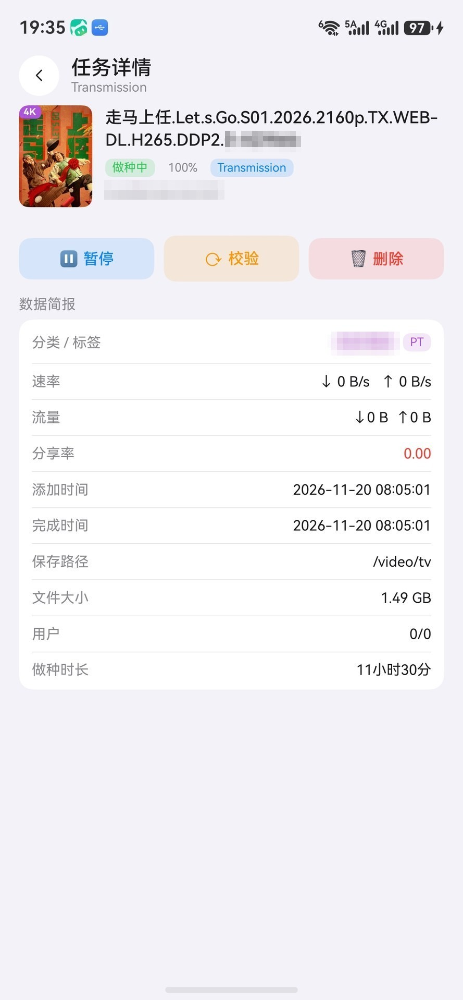
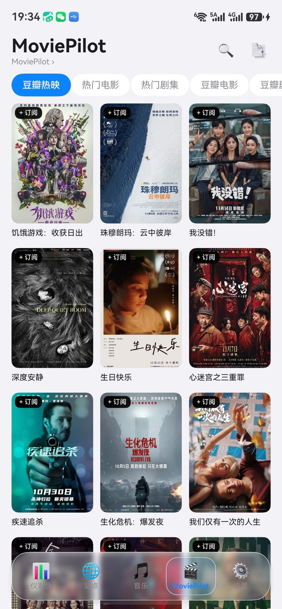
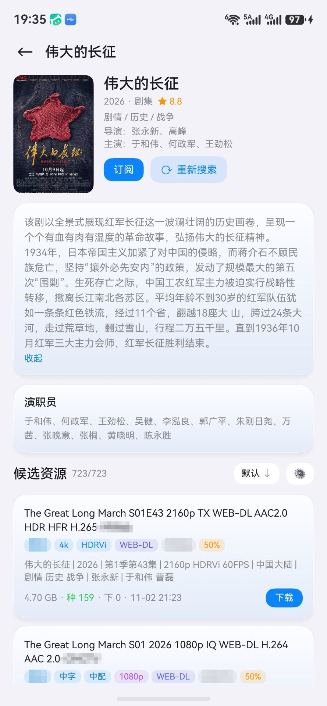
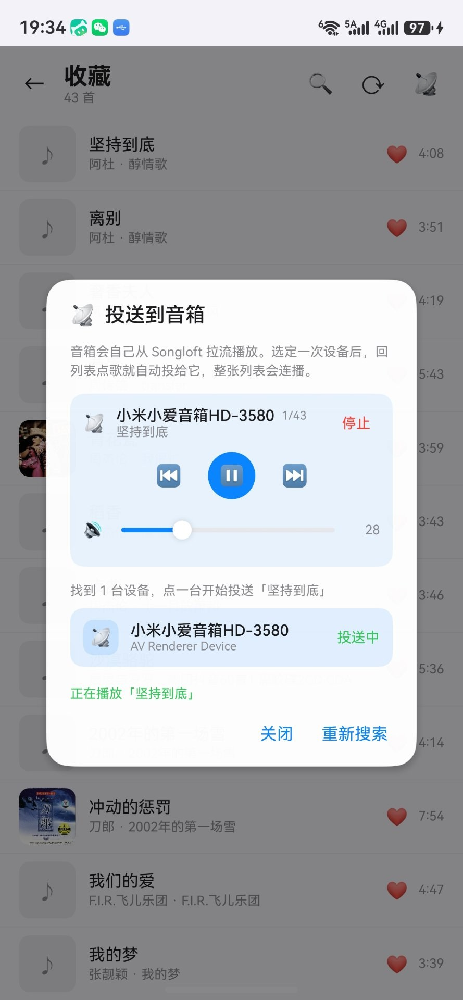
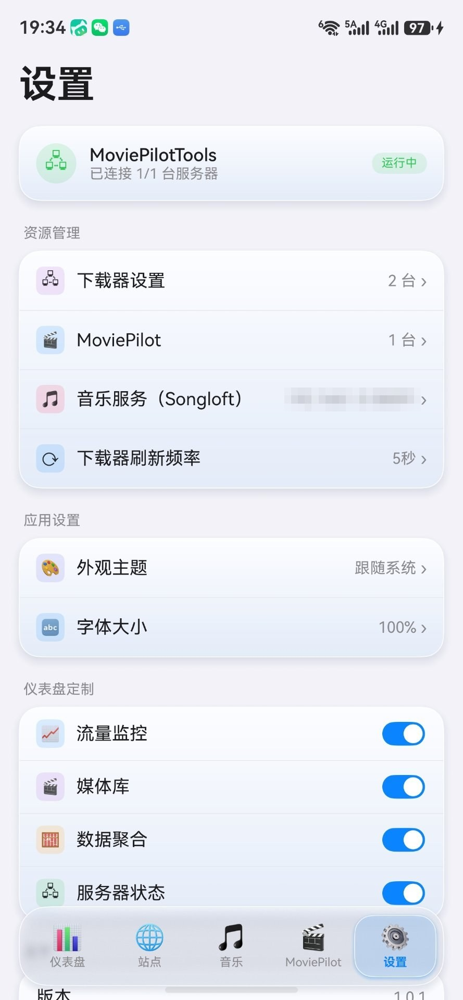

<p align="center">
  
</p>

<h1 align="center">MoviePilotTools</h1>

<p align="center">
  Android / HarmonyOS 上的下载器 / MoviePilot / Songloft 一体化管理客户端<br>
  <strong>v1.0.2</strong> · Android 8.0+（API 26）· HarmonyOS 5.0+ · GPL-3.0
</p>

在手机上管你的 qBittorrent、Transmission、MoviePilot 和 Songloft 音乐库：看任务、加种子、查媒体、点歌、投送到音箱。

两端独立实现、功能对齐：**Android** 用 Kotlin + Jetpack Compose + Media3，**HarmonyOS** 用 ArkTS + ArkUI + AVPlayer。投送都用最通用的 DLNA —— 不依赖任何私有协议。

> English: MoviePilotTools is an Android / HarmonyOS client for qBittorrent, Transmission, MoviePilot and Songloft, released under GPL-3.0.

---

## 界面预览

**下载管理**

<table>
  <tr>
    <th>仪表盘</th>
    <th>服务器与系统信息</th>
    <th>传输任务</th>
    <th>任务详情</th>
  </tr>
  <tr>
    <td align="center"><a href="docs/screenshots/dashboard.jpg"></a></td>
    <td align="center"><a href="docs/screenshots/dashboard-servers.jpg"></a></td>
    <td align="center"><a href="docs/screenshots/tasks.jpg"></a></td>
    <td align="center"><a href="docs/screenshots/task-detail.jpg"></a></td>
  </tr>
</table>

**MoviePilot**

<table>
  <tr>
    <th>影视发现</th>
    <th>媒体详情与候选资源</th>
  </tr>
  <tr>
    <td align="center"><a href="docs/screenshots/moviepilot.jpg"></a></td>
    <td align="center"><a href="docs/screenshots/moviepilot-detail.jpg"></a></td>
  </tr>
</table>

**音乐与设置**

<table>
  <tr>
    <th>正在播放</th>
    <th>投送到音箱</th>
    <th>设置</th>
  </tr>
  <tr>
    <td align="center"><a href="docs/screenshots/player.jpg"></a></td>
    <td align="center"><a href="docs/screenshots/casting.jpg"></a></td>
    <td align="center"><a href="docs/screenshots/settings.jpg"></a></td>
  </tr>
</table>

## 功能

| 模块 | 能做什么 |
| --- | --- |
| 多下载器 | 同时配置多台 qBittorrent / Transmission，一键切换或合并查看，记住当前服务器 |
| 任务 | 列表、搜索、状态筛选；批量开始/暂停/删除；详情看文件与进度；添加磁力/种子链接；预设下载目录 |
| 仪表盘 | 实时上下行速率、累计流量、磁盘剩余、服务器在线状态、MoviePilot 媒体库统计（电影 / 电视剧 / 剧集 / 用户数） |
| MoviePilot | 多实例配置、首页发现、关键词搜索、媒体详情与资源列表、一键提交下载（可选默认下载器与保存路径） |
| 音乐（Songloft） | 歌曲列表与歌单、搜索、按歌单播放；本机播放（ExoPlayer，支持 FLAC/24bit）；锁屏与通知栏控制；DLNA 投送到音箱，整张列表自动连播；投送时也能调音箱音量、拖进度 |
| 设置 | 服务器与 MoviePilot 配置、音乐服务配置（支持内网 IP + 外网域名，连不通自动换下一个）、预设下载目录、下载器刷新频率、**本地备份与恢复**、深浅主题、关于 |

### 本地备份与恢复

设置 → 资源管理 → 「本地备份」/「从备份恢复」。备份包含下载器、MoviePilot、RSS 源、音乐服务、外观设置等全部配置，导出为 `.mptbak` 文件：

- **导出时输入密码**：PBKDF2 + AES-256-GCM 加密，密码忘记无法找回，但可放心存网盘。
- **留空不加密**：明文 JSON，导入即用，注意文件里有账号与 API Key，别外传。
- **两端通用**：安卓导出的备份能恢复到鸿蒙，反之亦然。卸载重装、换机后凭密码恢复即可，不用重新填。
- 恢复是**整包覆盖**，操作前会二次确认。

### 几个细节

- **地址自动探测**：每台服务都可以填多行地址（例如 `192.168.1.10:8080` 和 `https://mp.example.com`）。连之前先探测，谁通用谁；中途断线只在网络错误时切下一行，业务报错（401/404）不会偷偷换地址掩盖问题。
- **点歌即播**：一旦处于投送状态，点歌直接推到音箱并把当前列表变成投送队列，不用再点右上角投送。
- **投送连播**：DLNA 本身没有队列概念，这里每 2.5 秒问一次音箱状态，播完自动推下一首；同时有三种结束判定，兼容"放完仍报 PLAYING"的设备。
- **本机 / 投送状态合并**：界面只有一份播放状态，投送时显示的是音箱那首，列表高亮、进度、暂停键不会跟实际声音对不上。

## 安装

### Android

从 [Releases](https://github.com/shbsky/MoviePilotTools/releases) 下载 `MoviePilotTools-android-v1.0.2.apk` 直接安装（需要允许安装未知来源应用）。

> **应用内更新**：「设置 → 应用更新」发现新版本时点「立即更新」，App 会自己下载安装包并在下载完直接拉起系统安装器，不用再打开浏览器。首次使用系统要求允许「安装未知应用」，开一次开关、之后每次都是自动续上安装。

### HarmonyOS

鸿蒙版**暂不上架应用市场**，仓库也不提供 `.hap` 安装包（调试证书与设备 UDID 绑定，别人装不上会报「签名校验失败」）。要装鸿蒙版，请按下面的「从源码构建 → HarmonyOS」自己编一个，用你自己的开发者证书签名。

顺带说明：`.hap` 只能装在 HarmonyOS NEXT 设备上，Android 手机不认这个格式，解析都不会发生。

应用不收集任何数据，配置（服务器地址、账号、Token）只保存在本机，Android 侧用 Keystore 加密存储，鸿蒙侧用应用沙箱内的软件密钥加密存储。

使用前请阅读 [用户协议](TERMS.md)：本工具是远程管理客户端，APP 本地不产生、不存储、不分发任何媒体 / 种子资源，所有内容均来自你自己部署的后端。

## 从源码构建

### Android

环境：JDK 17、Android SDK Platform 35。

```bash
cd android
./gradlew assembleRelease
# 产物：android/app/build/outputs/apk/release/app-release.apk
```

签名：仓库**不包含**签名密钥。放一份 `android/keystore/moviepilottools.jks`，或在 `android/local.properties` 里指定：

```properties
mpt.storeFile=keystore/moviepilottools.jks
mpt.storePassword=***
mpt.keyAlias=***
mpt.keyPassword=***
```

签名口令只从 `local.properties` 读取（该文件不进仓库，代码里不保留任何默认口令）。没有密钥也能编出未签名的 release 包（无法直接安装）。

### HarmonyOS

环境：DevEco Studio 5.0+、HarmonyOS SDK 26（API 26，`compatibleSdkVersion 26.0.0`）。

工程在 `harmony-app/MoviePilotTools-Harmony/`。签名配置**不进仓库**（里面是本机绝对路径和签名口令），仓库给的是脱敏模板：

```bash
cd harmony-app/MoviePilotTools-Harmony
cp build-profile.example.json5 build-profile.json5   # 然后填入自己的签名材料
```

用自己的华为账号在 DevEco Studio 里自动生成调试证书（File → Project Structure → Signing Configs → Automatically generate signature），它会把这几个字段写进 `build-profile.json5`：

```json5
certpath:        './signing/default.cer'
profile:         './signing/default.p7b'
storeFile:       './signing/default.p12'
storePassword:   '<FILL_IN>'
keyAlias:        'debugKey'
keyPassword:     '<FILL_IN>'
```

`signing/` 目录同样已在 `.gitignore` 中。配好后命令行构建：

```bash
# Windows（DevEco 自带 node）
export DEVECO_SDK_HOME="<DevEco Studio>/sdk"
node "<DevEco Studio>/tools/hvigor/bin/hvigorw.js" assembleHap \
  --mode module -p product=default -p buildMode=release --no-daemon
# 产物：entry/build/default/outputs/default/entry-default-signed.hap
```

装到自己的鸿蒙设备：`hdc install -r entry-default-signed.hap`（设备需开启开发者模式与 USB 调试）。

## 许可证

本项目以 **GNU General Public License v3.0** 发布（见 [LICENSE](LICENSE)），完整源码随仓库提供，可自由查看、修改、再分发。再分发修改版时请同样以 GPL-3.0 开放源码。

## 已知限制

- 双端（Android / HarmonyOS NEXT）功能基本对齐。鸿蒙版未上架应用市场，只能按源码自行编译安装；Android 手机不支持 `.hap`。
- 本项目只提供 Android 与 HarmonyOS 端，不提供 iOS 端。
- DLNA 投送依赖音箱固件：部分设备不支持 App 调音量或拖动进度，会给出提示而不是静默失败。
- 歌曲封面取决于 Songloft 曲库里是否刮削到封面（`cover_url`），没有封面时显示渐变占位。
- 歌词、均衡器、离线下载暂未实现。
- RSS 自动化引擎的代码仍在仓库里（`RssWorker` / `AutomationScreen`），但音乐标签占用了原来的 RSS 入口，界面上暂不开放。

## 致谢

- [MoviePilot](https://github.com/jxxghp/MoviePilot)、[qBittorrent](https://www.qbittorrent.org/)、[Transmission](https://transmissionbt.com/)、Songloft —— 被管理的服务端。
