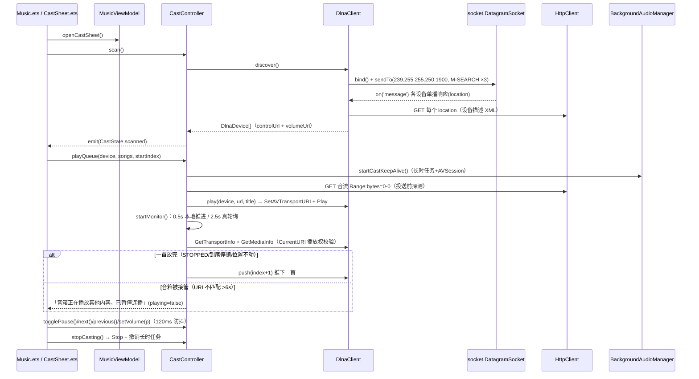
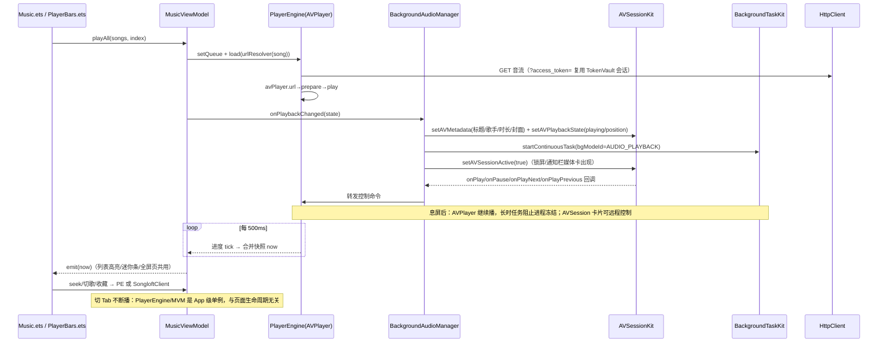
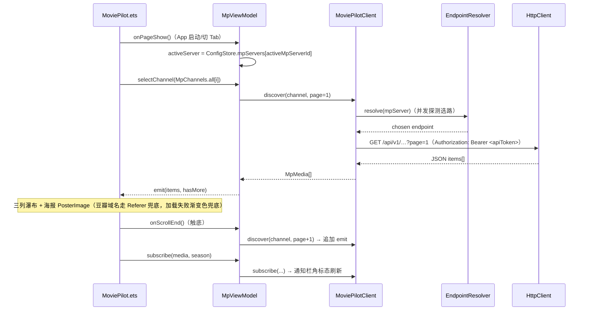
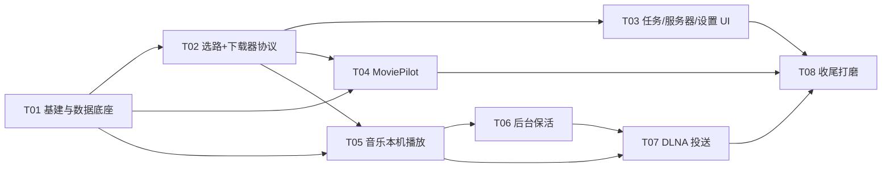

# MPtools 鸿蒙重制版 架构设计 + 任务分解

- 编写：Bob（架构师）｜ 输入：PRD.md（46+1 条，含 §7 用户决策 5 项）
- 目标：HarmonyOS NEXT（API 26 / ArkTS stage 模型 / 严格模式），真机 Mate 80 Pro Max
- 基准：安卓版 MoviePilotTools（data/net/ui/vm/player 五层，48 个 Kotlin 文件）逐文件映射移植
- 硬性约束：**零第三方依赖**（全部 @ohos/* / @kit/* 原生能力）；现有壳工程的 oh-package.json5 / hvigor / build-profile / 签名配置**一律不动**；现有 ets 源码为已否决骨架，推倒重写
- 应用显示名：**MPtools**（bundle 保持 com.moviepilottools.mptools）；应用图标：直接拷贝安卓版 ic_launcher.png，禁止另设计
- RSS 自动化：按用户决策「b」——RssModels + RssRuleEngine 代码级保留，**无页面入口、无后台轮询**
- DLNA 投送：P0（决策 a）；后台播放完整方案（决策 a：长时任务 + AVSession + 通知卡）；选路原样复刻并发探测（决策 a）

---

## Part A · 系统设计

### 1. 分层架构方案

#### 1.1 难点与技术选型

| 难点 | 安卓做法 | 鸿蒙 NEXT 方案 | 备注 |
|---|---|---|---|
| HTTP 客户端（Cookie 保持/超时分级/表单） | OkHttp + CookieJar + 拦截器 | `@kit.NetworkKit` 的 `http.createHttp()`，自封 `HttpClient` 单例：手动管理 `Set-Cookie`（按 host 存 SID）、三档超时（普通 6s/慢速 130s/探测 2.5s） | qB 登录 SID、Songloft Bearer、MP token 都在这一层统一补头（替代 OkHttp 拦截器） |
| 多端点并发探测选路 | 协程 + CompletableDeferred | `Promise.race` + `setTimeout` 预算（3200ms），`Promise.allSettled` 兜底收尾；缓存 10 分钟 | 原样复刻「AUTO 并发选最快 / MANUAL 固定 / 失败失效重探」语义 |
| JSON 动态解析 | kotlinx.serialization / org.json | 手写 `fromJsonXxx(): T \| null` 映射函数（字段级安全访问），**禁 any / 禁匿名对象** | ArkTS 严格模式硬约束，见 §8 共享约定 |
| MP 跨站资源搜索流式解析 | OkHttp 流式 body 边收边解析 | `http.createHttp().requestInStream()`，`on('dataReceive')` 增量喂 JSON 行解析器 | 匹配安卓「边收边显示」体验；无流式能力时降级为整包+分批渲染 |
| 音频播放 | ExoPlayer（进程级单例） | `@kit.AudioKit` `AVPlayer`（状态机，url 设置→prepare→play），封进 `PlayerEngine` TS 单例 | 播放器与界面/后台服务共用同一实例（对应 PlaybackCore.kt 的设计意图） |
| 后台播放保活 | Media3 MediaSessionService | `@kit.AVSessionKit`（AVSession + LockScreen  卡片）+ `@kit.BackgroundTaskKit`（`startContinuousTask`，bgModeId=AUDIO_PLAYBACK） | 详见 §6 |
| DLNA/SSDP 组播 | DatagramSocket + MulticastLock | `@ohos.net.socket` `DatagramSocket`（bind→sendTo 组播 239.255.255.250:1900→on('message') 收单播响应） | NEXT 无 MulticastLock 等价 API，风险与降级见 §5 |
| SOAP / XML | 手写 SOAP + XmlPullParser | SOAP 手写不变（HTTP POST）；设备描述 XML 用**正则标签提取**（安卓源码里 SOAP 响应本来就是正则提取，统一化） | 无第三方 XML 解析器 |
| 配置持久化（加密） | SharedPreferences + KeyStore AES/GCM | `@kit.ArkData` `preferences`（整体 JSON 字符串）+ `@kit.CryptoArchitectureKit` AES-256-GCM | 密钥降级方案见 §5/§9 |
| 令牌持久化 | SharedPreferences + CryptoBox | 同上（TokenVault → preferences） | 防 Songloft 登录限流 |
| VM 层 | AndroidViewModel + StateFlow | **纯 TS 单例类**（不用 ArkTS ViewModel 概念）：`ObservableStore` 基类（listener 注册 + 不可变快照替换）；页面在 aboutToAppear 订阅、把快照赋给 `@State` | 切 Tab 不断播/不断轮询的关键：VM 生命周期 = App 生命周期，与页面解耦 |
| UI 框架 | Compose + 5 Tab + BackHandler 链 | ArkUI 声明式：根 `Navigation`（隐藏标题栏，NavPathStack 管全局覆盖层栈）→ 首页 `Tabs`（5 Tab，自定义悬浮胶囊 tabBar）→ 覆盖层页面为 NavDestination | Navigation 自带返回手势/栈管理，替代安卓 BackHandler 逐层回退链（PRD #42） |
| 图片加载（豆瓣 Referer） | OkHttp 拦截器（Glide/Coil 无关，直接 URL） | `DoubanImageProvider`：http 带 Referer 拉字节流 → `@kit.ImageKit` `image.createImageSource(bytes)` → PixelMap → `Image(pixelMap)` | ArkUI `Image(url)` 无法加请求头，必须走自定义组件（P1 #39） |
| 后台轮询 RSS | WorkManager | 不做（用户决策 b：RSS 不提供入口、无后台） | RssRuleEngine 仅代码级保留 |

#### 1.2 分层映射（安卓 → ArkTS）

```
android/data     → ets/model/（纯数据结构）+ ets/data/（持久化、加密、规则引擎）
android/net      → ets/net/  （HttpClient + EndpointResolver + 6 个协议客户端 + DlnaClient + DoubanImageProvider）
android/vm       → ets/vm/   （StoreBase + AppViewModel + MpViewModel + MusicViewModel，纯 TS 单例）
android/player   → ets/player/（PlayerEngine + BackgroundAudioManager + CastController）
android/ui       → ets/ui/   + ets/pages/Index.ets（Navigation+Tabs 根）+ ets/ui/components/
android/ui/theme → ets/common/Theme.ets（色板与 Theme.kt 完全对齐）
```

依赖方向：`ui → vm → net/player → model/data`。VM 之间：MusicViewModel 合并 PlayerEngine（本机）与 CastController（投送）两路状态为单一 `PlaybackState`（对齐安卓 MusicViewModel.merge()）。

#### 1.3 状态管理方案

- **页面内**：`@State`（快照对象）+ `aboutToAppear` 向 VM 注册 listener、`aboutToDisappear` 注销。
- **跨页全局**：`AppStorage`（主题模式、字体缩放、迷你播放条可见性、全局 Toast 事件、投送中标志——供所有 Tab 的顶栏图标变色使用）。Theme/FontScale 用 `@StorageLink`。
- **覆盖层路由**：`NavPathStack`（Index.ets 持有，经 `@Provide` 下发）：`taskDetail` / `serverList` / `serverEdit` / `mpServerList` / `mpServerEdit` / `nowPlaying` 六个 NavDestination，系统返回手势自动逐层弹栈。
- **全屏弹层（非路由）**：投送弹窗、Songloft 配置弹窗、筛选抽屉、投递抽屉、删除确认——用 `@State` 控制 + 半模态 `bindSheet` / 自定义浮层。

---

### 2. 完整文件列表（entry/src/main/ets/，共 43 个 ets 文件 + 2 个资源动作）

#### common/（3）
| 文件 | 职责 | 对应安卓源文件 |
|---|---|---|
| common/Theme.ets | 色板 Palette、OiiColors（明暗两套）、圆角/间距 Metrics、字体缩放常量 | ui/theme/Theme.kt |
| common/Format.ets | 速度/体积/时间/相对时间格式化（「3 小时前」#46） | data/Format.kt |
| common/AppConstants.ets | 日志 TAG 前缀、持久化 key、轮询间隔枚举、共享常量 | （散落各处常量收拢） |

#### model/（5）——纯数据结构，无逻辑依赖
| 文件 | 职责 | 对应安卓源文件 |
|---|---|---|
| model/Models.ets | ServerType、Endpoint（normalized/hostKey/url）、parseEndpoints、ServerConfig、TorrentStatus（状态色）、TorrentTask、ServerSnapshot、EndpointMode | data/Models.kt |
| model/Settings.ets | AppSettings、PersistedState | data/ConfigStore.kt（模型部分） |
| model/MpModels.ets | MpServer、MpMedia、MpResource（促销/分辨率/质量/编码推导）、ResourceFilter、ResourceSortField、MpDownloader、MpSavePath、MpSubscribe、MpStatistic、MpChannels（12 频道表） | data/MpModels.kt + vm/MpViewModel.kt（MpChannels） |
| model/MusicModels.ets | MusicSong、MusicPlaylist、MusicLibraryStats、MusicUiState、PlaybackState、formatDuration | data/MusicModels.kt |
| model/RssModels.ets | HeaderPair、RssSource、RssItemRecord（代码级保留，无入口） | data/RssModels.kt |

#### data/（4）
| 文件 | 职责 | 对应安卓源文件 |
|---|---|---|
| data/CryptoBox.ets | AES-256-GCM 加解密（cryptoFramework），"enc:" 前缀降级明文读取 | data/ConfigStore.kt（CryptoBox） |
| data/ConfigStore.ets | PersistedState ↔ preferences（key=state_v1），load/save + 解析失败重置 | data/ConfigStore.kt |
| data/TokenVault.ets | Songloft access_token 持久化（base/token/expiresAt） | data/TokenVault.kt |
| data/RssRuleEngine.ets | RSS 规则匹配引擎（include/exclude/体积/集数过滤），代码级保留 | data/RssRuleEngine.kt |

#### net/（8）
| 文件 | 职责 | 对应安卓源文件 |
|---|---|---|
| net/HttpClient.ets | http 封装单例：get/post/postForm/JSON body、按 host 的内存 CookieJar、三档超时（普通/慢速/探测）、统一 ApiException | net/Net.kt |
| net/EndpointResolver.ets | AUTO 并发探测选最快（预算 3.2s、缓存 10min）、MANUAL 固定、invalidate、candidates 顺序 | net/EndpointResolver.kt |
| net/QBittorrentClient.ets | qB 协议：登录（Cookie 或 API Key Bearer 双通道）、任务增删改查/暂停/继续/校验/汇报、全局统计、剩余空间 | net/QBittorrentClient.kt |
| net/TransmissionClient.ets | Transmission RPC：会话 ID 获取与 409 重试、可配 rpcPath、任务/统计 | net/TransmissionClient.kt |
| net/MoviePilotClient.ets | MP 协议：发现频道分页、搜索、媒体详情/演职员、订阅 CRUD、跨站资源搜索（requestInStream 流式）、下载器/保存路径、投递、仪表盘统计 | net/MoviePilotClient.kt |
| net/SongloftClient.ets | Songloft 协议：登录（token 复用+401 重登一次）、歌曲/歌单/统计/收藏、流地址拼接（?access_token=）、多地址轮换；内含 SongloftSession（替代安卓 AuthInterceptor 的全局头注入） | net/SongloftClient.kt + SongloftAuthInterceptor.kt |
| net/DlnaClient.ets | SSDP M-SEARCH 组播发现、设备描述解析（AVTransport/RenderingControl controlURL）、SOAP 动作（SetAVTransportURI/Play/Pause/Stop/Seek）、GetTransportInfo/GetMediaInfo/GetVolume/SetVolume | net/dlna/DlnaClient.kt |
| net/DoubanImageProvider.ets | 带 Referer 请求头拉豆瓣图片字节 → PixelMap（P1 #39） | net/DoubanImageHeaderInterceptor.kt + PosterUrl.kt |
| net/PosterUrl.ets | 海报地址推导（豆瓣/TMDB/MP 接口三级兜底） | net/PosterUrl.kt |

#### player/（3）
| 文件 | 职责 | 对应安卓源文件 |
|---|---|---|
| player/PlayerEngine.ets | AVPlayer 进程级单例：加载/播放/暂停/上下首/进度/音量/循环三档、urlResolver 注入、播放状态快照（对应 PlaybackState 本机部分） | player/PlaybackCore.kt + MusicPlayer.kt |
| player/BackgroundAudioManager.ets | AVSession 注册（元数据/播放态/回调）+ startContinuousTask(AUDIO_PLAYBACK) 保活 + 通知卡元数据同步（详见 §6） | player/MusicService.kt + CastService.kt |
| player/CastController.ets | DLNA 投送状态机单例：扫描、playQueue 整表连播、2.5s 轮询 + 0.5s 本地推进、播放权校验（CurrentURI/时长兜底）、假播放侦测、音量防抖 | vm/CastController.kt |

#### vm/（4）
| 文件 | 职责 | 对应安卓源文件 |
|---|---|---|
| vm/StoreBase.ets | ObservableStore 基类（listener/emit/快照替换）+ ToastHub 全局 Toast（2.2~2.4s，#41） | （安卓由 Compose state 承担，收拢） |
| vm/AppViewModel.ets | 下载器域：服务器 CRUD、端点探测、轮询刷新（可配间隔）、ServerSnapshot 汇总、任务列表/筛选/排序状态、任务六操作、仪表盘聚合数据、设置项写入 | vm/AppViewModel.kt |
| vm/MpViewModel.ets | MP 域：多服务器管理、发现页分页、搜索、详情/演职员、资源搜索状态机（searchStage）、筛选器、投递、订阅列表、媒体库统计 | vm/MpViewModel.kt |
| vm/MusicViewModel.ets | 音乐域：Songloft 配置接入、歌曲/歌单/分页/防抖搜索、收藏切换、**本机+投送合并的 now 状态**、播放控制转发 | vm/MusicViewModel.kt |

#### pages/ + entryability/（2）
| 文件 | 职责 | 对应安卓源文件 |
|---|---|---|
| pages/Index.ets | 根：Navigation(home=Tabs 壳) + 悬浮胶囊 TabBar + MiniPlayerBar 常驻挂载 + 6 个 NavDestination（任务详情/服务器列表/服务器编辑/MP服务器列表/MP服务器编辑/全屏播放页）+ ToastHost + 主题应用 | MainActivity.kt |
| entryability/EntryAbility.ets | 生命周期：onWindowStageCreate 加载 Index；onForeground 恢复轮询、onBackground 暂停轮询；AVSession/长时任务挂载点 | MainActivity.kt + OiiQTApplication.kt |

#### ui/（12）
| 文件 | 职责 | 对应安卓源文件 |
|---|---|---|
| ui/components/Common.ets | 通用件：圆角卡片、Pill、状态点、下拉选择器、确认弹窗、ToastHost、筛选 Chip、空态（含渐变兜底 #43） | ui/components/Components.kt + Fields.kt |
| ui/components/PosterImage.ets | 海报组件（豆瓣域名走 Referer 兜底、加载失败渐变色兜底 #43） | ui/components/Components.kt（posterFallback） |
| ui/dashboard/Dashboard.ets | 仪表盘：Hero 卡（服务器下拉）、流量瓦片、媒体库、数据聚合、服务器状态卡（钻入任务页）、四模块开关响应 | ui/dashboard/DashboardScreen.kt |
| ui/transfers/Transfers.ets | 任务页：搜索框、状态/分类/标签筛选条、五种排序、汇总行、任务卡（进度/状态色/速度/Peer） | ui/transfers/TransfersScreen.kt |
| ui/transfers/TorrentDetail.ets | 任务详情：数据简报网格、六操作按钮、信息行、删除二次确认（含删文件开关） | ui/transfers/TorrentDetailScreen.kt |
| ui/settings/Settings.ets | 设置页全量：状态卡、资源管理组、外观（主题/字体）、仪表盘定制、关于弹窗、音乐服务配置弹窗（多行探测/账密/测试） | ui/settings/SettingsScreen.kt |
| ui/settings/ServerScreens.ets | 下载器服务器列表/编辑（类型选择、多端点行、选路方式、认证双通道、rpcPath、逐条探测 ✓/✕、删除确认） | ui/settings/ServerScreens.kt |
| ui/moviepilot/MoviePilot.ets | MP 主页：顶栏（服务器名/搜索/订阅入口）、频道 Pill 横滑、三列海报瀑布（分页+订阅角标）、搜索页 | ui/moviepilot/MoviePilotScreen.kt |
| ui/moviepilot/MediaDetail.ets | 媒体详情：背景图+信息+订阅、演职员横滑、候选资源区（搜索按钮+耗时文案）、排序/筛选行、FilterSheet、DownloadSheet、资源行（促销角标/徽章） | ui/moviepilot/MediaDetailScreen.kt |
| ui/moviepilot/MpServerScreens.ets | MP 服务器列表/编辑（Token 必填校验、多端点、测试、删除） | ui/moviepilot/MpServerScreens.kt |
| ui/music/Music.ets | 音乐页：顶栏（搜索/刷新/投送图标）、歌单横滑卡、全部歌曲+播放全部、歌曲行（红心/高亮）、歌单详情视图、防抖搜索 | ui/music/MusicScreen.kt |
| ui/music/PlayerBars.ets | MiniPlayerBar（常驻迷你条）+ NowPlayingScreen（沉浸封面、44dp 进度条、循环三档、弹出音量条、编码信息行） | ui/music/PlayerBars.kt |
| ui/music/CastSheet.ets | 投送弹窗：设备列表（扫描/扫描中）、投送中面板（进度/五键/音量）、设备行单投 | ui/music/CastSheet.kt |

#### 资源动作（非 ets）
- `AppScope/resources/base/media/app_icon.png` ← 拷贝安卓 `mipmap-xxxhdpi/ic_launcher.png`（覆盖同名，不改引用）
- `entry/src/main/resources/base/media/icon.png` ← 同一 png 覆盖（entry module.json5 引 $media:icon）
- `entry/src/main/module.json5`：requestPermissions 增加 `ohos.permission.KEEP_BACKGROUND_RUNNING`（B6 批次时加）

**合计：43 个 ets 源文件 + 2 个资源覆盖 + 1 个 manifest 增量。**

---

### 3. 关键数据结构（照安卓模型裁剪，ArkTS 形态）

> 全部为 `interface`（数据形状）+ `class`（带派生 getter 的行为体）+ `enum`；字段全类型标注，禁 any。

```ts
// model/Models.ets（节选）
export enum ServerType { QBITTORRENT, TRANSMISSION }
export enum EndpointMode { AUTO, MANUAL }
export enum TorrentStatus { DOWNLOADING, QUEUED, SEEDING, PAUSED, CHECKING, ERROR, COMPLETED }

export interface EndpointData { host: string; port: number; https: boolean; basePath: string; label: string; enabled: boolean }
export class Endpoint {
  // 构造自 EndpointData；派生方法：
  isValid(): boolean; effectivePort(): number; display(): string;
  normalized(): Endpoint; url(path: string): string; hostKey(): string;
}
export function parseEndpoints(text: string): Endpoint[];   // 多行拆端点，# 注释行忽略，hostKey 去重
export function summarizeEndpoints(text: string): string;

export class ServerConfig {
  id: string; name: string; type: ServerType; endpoints: Endpoint[];
  username: string; password: string; apiKey: string; useApiKey: boolean;
  rpcPath: string; endpointMode: EndpointMode; pinnedEndpointIndex: number; hidden: boolean;
  displayName(): string; activeEndpoints(): Endpoint[];
}

export interface TorrentTaskData { hash: string; serverId: string; serverType: ServerType; name: string;
  progress: number; size: number; downloaded: number; uploaded: number; downloadSpeed: number; uploadSpeed: number;
  status: TorrentStatus; etaSeconds: number; ratio: number; numSeeds: number; numPeers: number;
  category: string; tags: string[]; savePath: string; trackerHost: string;
  addedAt: number; completedAt: number; seedingSeconds: number; errorMessage: string; }
export class TorrentTask { /* 派生: id / isFinished / taxonomyTags / hiddenTaxonomyCount / accentColor */ }
export class ServerSnapshot { serverId: string; online: boolean; error: string; downloadSpeed: number; ... ; ratio(): number }

// model/MpModels.ets（节选）
export class MpResource { key: string; siteName: string; title: string; sizeBytes: number; seeders: number;
  peers: number; downloadFactor: number; uploadFactor: number; hitAndRun: boolean; pubDateMs: number; rawJson: string; ...
  isFree(): boolean; promotionLabel(): string; resolution(): string; quality(): string; codec(): string; }
export class ResourceFilter { site: string | null; resolution: string | null; quality: string | null; codec: string | null;
  promotionOnly: boolean; hideHitAndRun: boolean; sortField: ResourceSortField; descending: boolean;
  activeCount(): number; apply(list: MpResource[]): MpResource[]; }
export class MpSubscribe { id: number; name: string; state: string; totalEpisode: number; lackEpisode: number; ...
  stateLabel(): string; progressText(): string; progress(): number; }

// model/MusicModels.ets（节选）
export class MusicSong { id: number; title: string; artist: string; album: string; durationSeconds: number;
  streamUrl: string; coverUrl: string; format: string; bitRate: number; isVideo: boolean; }
export class PlaybackState { current: MusicSong | null; isPlaying: boolean; positionMs: number; durationMs: number;
  volume: number; repeatMode: number /* 0 列表停 / 1 单曲 / 2 列表循环 */; castingTo: string | null; error: string | null;
  progress(): number; }

// player/CastController.ets
export class CastState { scanning: boolean; scanned: boolean; devices: DlnaDevice[]; active: DlnaDevice | null;
  queue: MusicSong[]; index: number; playing: boolean; volume: number /* -1 未知 */; volumeSupported: boolean;
  positionMs: number; durationMs: number; message: string | null; casting(): boolean; }

// net/DlnaClient.ets
export class DlnaDevice { name: string; model: string; location: string; controlUrl: string; volumeUrl: string;
  volumeSupported(): boolean; }
export class DlnaTransport { state: string; positionMs: number; durationMs: number; }
```

---

### 4. 核心调用流程时序

> 4 张完整 mermaid 图已同时落盘：`docs/sequence-diagram.mermaid`（合并 4 图）；类图见 `docs/class-diagram.mermaid`。

#### 4.1 投送音箱全链路（发现→投送→连播→被接管让位）



#### 4.2 音乐播放 + 后台保活



#### 4.3 多端点并发探测选路

```mermaid
sequenceDiagram
    participant VM as AppViewModel / MpViewModel / SongloftClient
    participant ER as EndpointResolver
    participant HTTP as HttpClient(probeClient 2.5s 超时)

    VM->>ER: resolve(cacheKey, endpoints, mode, probe)
    alt MANUAL
        ER->>HTTP: probe(pinned)
        alt 通
            ER-->>VM: pinned（写入缓存 10min）
        else 不通
            ER->>ER: 回退并发探测其余端点
        end
    else AUTO 且缓存未过期
        ER-->>VM: cachedEndpoint 直接命中
    else AUTO 无缓存
        par 并发探测所有候选
            ER->>HTTP: probe(ep1)（GET 指定 path，2xx/401/403 视为可达）
        par
            ER->>HTTP: probe(ep2)
        par
            ER->>HTTP: probe(epN)
        end
        ER->>ER: Promise.race 取最先成功者（预算 3200ms）
        ER->>ER: remember(cacheKey, winner)
        ER-->>VM: winner
    end
    Note over VM: 请求失败时 VM→ER.invalidate(cacheKey)，下次重探（安卓语义 1:1）
```

#### 4.4 MP 发现页数据流



---

### 5. DLNA/SSDP 在鸿蒙 NEXT 的实现方案与风险

#### 实现方案（net/DlnaClient.ets）
1. **发现**：`socket.constructUDPDatagramSocket()` → `bind({address:'0.0.0.0', port:0})` → `setBroadcast(true)` → `send({data: M-SEARCH 文本（ST: MediaRenderer:1，MX:2）}, {address:'239.255.255.250', port:1900})` 连发 3 次 → `on('message')` 收单播响应，提取 `LOCATION` 头，去重入 LinkedHashSet，4 秒窗口结束。
2. **设备描述**：HttpClient GET location → 正则提取 `friendlyName / modelName / deviceType / serviceType / controlURL`（按 service 块归组取 AVTransport 与 RenderingControl 的 controlURL，`URI.resolve` 语义手写 absolute()）；无 AVTransport 直接丢弃。
3. **控制**：SOAP POST 不变（SOAPACTION 头 + envelope + DIDL-Lite），错误取 `errorDescription`。音量走 RenderingControl，GetVolume/SetVolume + 120ms 防抖。
4. **连播状态机**：CastController 完整移植安卓版——0.5s tick 本地推进、每 5 tick 真轮询 GetTransportInfo/GetPositionInfo、GetMediaInfo CurrentURI 播放权校验 + 时长差异兜底、假播放侦测、推流后 4s 完成判定屏蔽、失败 15s 不自动重推。

#### 风险与验证点
| # | 风险 | 真机验证点 | 降级方案 |
|---|---|---|---|
| R1 | 组播**发送**被拒（sendTo 239.x 抛 234000x 错误码） | B7 首日验证：日志确认 send 无异常、能在路由器侧抓包（可选） | 改发 UDP **广播** 255.255.255.255:1900（多数音箱同样响应广播 M-SEARCH） |
| R2 | 组播/广播**接收**被系统 Wi-Fi 休眠策略过滤（安卓 MulticastLock 在 NEXT 无等价物） | 与音箱同 WiFi 下扫描 4 秒，观察 on('message') 是否有任何包 | ① bind 固定 1900 端口 + addMembership 提升收包率；② App 扫描期间用 `wifi.setWifiScanActive`?（不可用则跳过）；③ 手动填设备 description.xml URL 兜底 |
| R3 | `socket.addMembership` 在 API 26 的签名/行为与文档不一致 | 按真机 d.ts 核对签名；try/catch 包裹不阻断主流程 | 跳过 membership（单播响应不依赖它） |
| R4 | 明文 HTTP 受网络安全策略限制 | 已有 network_config.json（cleartextTrafficPermitted: true），SOAP/描述 XML 都是 http，装机实测 | 已覆盖 |
| R5 | 音箱连接 URL（Songloft 流）走局域网 IP，手机 4G 下投送必然失败 | 提示文案已有（安卓版同款） | 沿用安卓行为 |

---

### 6. 后台播放方案（kit 调用链）

目标：熄屏续播、锁屏封面卡、通知栏媒体控制（上一首/播放暂停/下一首）、耳机按键可用。对应安卓 Media3 MediaSessionService。

**调用链（方法签名以 API 26 SDK d.ts 为准，实现时逐一核对）：**
1. `@kit.AVSessionKit` → `avSessionManager.createAVSession(context, 'mptools_music', 'MPtools 播放', AVSessionType.AUDIO)`（App 启动或首次播放时创建一次，进程级）。
2. `session.setAVMetadata({ assetId, title, artist, duration, album, mediaImage(封面 PixelMap/url) })` — 换歌时同步。
3. `session.setAVPlaybackState({ state: PLAYBACK_STATE_PLAYING/PAUSED, position: {positionMs, updateTime}, speed, bufferedTime })` — PlayerEngine 每次 tick/状态变化同步（节流至 1s 一次 position）。
4. `session.setAVSessionCallback` 注册 `onPlay / onPause / onPlayNext / onPlayPrevious / onSeek` → 转发 PlayerEngine / CastController（投送时命令转发给 CastController，音箱才是真正播放者）。
5. `@kit.BackgroundTaskKit` → `backgroundTaskManager.startContinuousTask(id, { bgModeId: AUDIO_PLAYBACK })`（module.json5 申请 `ohos.permission.KEEP_BACKGROUND_RUNNING`）；停止时 `stopContinuousTask(id)`。
6. `session.setAVSessionActive(true)`：系统据 AVSession + 长时任务生成**通知栏媒体卡片/锁屏卡**，无需自建 notification（若 API 26 要求长时任务自带通知，则用 `@kit.NotificationKit` 发布一条带媒体样式的持续通知——实现时二选一，真机验证）。
7. 播放结束/投送停止：`setAVSessionActive(false)` + `stopContinuousTask` + `session.destroy()`（可选保留 session 复用）。

**与安卓的差异点（标注给工程师）**：
- 鸿蒙没有「Service」概念——BackgroundAudioManager 是 TS 单例 + Ability 上下文，不是独立组件；
- AVSession 命令回调是事件订阅制，需在 App 退出/页面销毁后仍存活（放单例里没问题）；
- 投送中（CastController 活动）也要维持 AVSession 卡片：`current` 取投送队列当前曲，命令转 CastController——对齐安卓 CastService 前台服务保活轮询的用途（长时任务同样防止息屏冻结轮询协程）。

---

## Part B · 任务分解

### 7. 必需的包（零第三方依赖确认）

```
- 无第三方运行时依赖。全部使用系统 kit：
  @kit.NetworkKit（http）、@kit.ArkData（preferences）、@kit.AudioKit（AVPlayer）、
  @kit.AVSessionKit、@kit.BackgroundTaskKit、@kit.ImageKit（PixelMap/封面）、
  @kit.CryptoArchitectureKit（AES-GCM）、@ohos.net.socket（UDP）、@kit.NotificationKit（如需自建媒体通知）
- devDependencies 保持 @ohos/hypium（现有），oh-package.json5 不改
```

### 8. 任务列表（8 个批次，每批 devecocli build 可过 + 独立可验收）

> 编译验证命令：`devecocli build`；真机：`devecocli run --device <设备序列号>`。
> oh-package.json5 / hvigor / build-profile / 签名**全程不动**。

---

**T01 · 工程基建与数据底座**（依赖：无｜P0）
- 做什么：清掉旧骨架、建全目录结构；主题与格式化工具；核心模型（Models/Settings）；HttpClient 封装（CookieJar+三档超时）；ConfigStore/CryptoBox/TokenVault；pages/Index 根壳（Navigation + 5 Tab 悬浮胶囊底栏 + 5 个占位页）；EntryAbility 接入；App 图标覆盖。
- 产出文件：entryability/EntryAbility.ets、pages/Index.ets、common/{Theme,Format,AppConstants}.ets、model/{Models,Settings}.ets、net/HttpClient.ets、data/{CryptoBox,ConfigStore,TokenVault}.ets、ui/components/Common.ets（首批基础件）、ui/{dashboard,transfers,moviepilot,music,settings} 5 个占位页、AppScope 与 entry 的 icon 资源覆盖。
- 验收：`devecocli build` 通过；真机启动见 5 Tab 悬浮胶囊底栏、明暗主题色板与安卓 Theme.kt 一致、图标为安卓版图标；配置加密落盘/读回 round-trip 通过（日志验证）。

**T02 · 选路引擎与下载器协议层**（依赖：T01｜P0）
- 做什么：EndpointResolver（并发探测/缓存/手动固定/失效）；QBittorrentClient（双认证）；TransmissionClient（409 重试）；StoreBase + ToastHub；AppViewModel（服务器 CRUD/轮询/快照/任务状态/六操作）。
- 产出：net/{EndpointResolver,QBittorrentClient,TransmissionClient}.ets、vm/{StoreBase,AppViewModel}.ets。
- 验收：build 通过；真机连真实 qB/tr：日志见端点并发探测选路命中、任务列表拉取、暂停/继续/删除 RPC 生效、409 会话 ID 重试生效。

**T03 · 任务/服务器/设置 UI**（依赖：T02｜P0）
- 做什么：任务页（筛选/排序/汇总/任务卡）、任务详情页、服务器列表/编辑（多端点编辑、逐条探测 ✓/✕）、设置页主体、仪表盘页（Hero/四模块/服务器卡钻入任务页）、MiniPlayerBar 占位（不激活）。
- 产出：ui/transfers/{Transfers,TorrentDetail}.ets、ui/settings/{ServerScreens,Settings}.ets、ui/dashboard/Dashboard.ets（重写 T01 占位）、pages/Index 接入 NavDestination 路由。
- 验收：build + 真机全流程：添加服务器→测试连接逐条结果→任务筛选排序→详情六操作→删除二次确认→仪表盘四模块开关持久化→返回键逐层回退。

**T04 · MoviePilot 全功能**（依赖：T02（复用 HttpClient/StoreBase/AppConstants）｜P0）
- 做什么：MpModels；MoviePilotClient（含 requestInStream 流式资源搜索）；MpViewModel；MP 三页 UI（发现/详情/服务器管理）+ FilterSheet/DownloadSheet。
- 产出：model/MpModels.ets、net/MoviePilotClient.ets、vm/MpViewModel.ets、ui/moviepilot/{MoviePilot,MediaDetail,MpServerScreens}.ets。
- 验收：build + 真机：12 频道分页瀑布、搜索、订阅/取消、跨站资源搜索边收边显、筛选/排序/促销角标、选下载器+路径投递、订阅列表操作、MP 服务器 Token 校验/测试。

**T05 · 音乐本机播放**（依赖：T01（TokenVault）+ T02（HttpClient/StoreBase）｜P0）
- 做什么：MusicModels；SongloftClient（token 复用/401 重登/多地址轮换）；PlayerEngine（AVPlayer 封装）；MusicViewModel（数据域+now 合并框架）；音乐页/迷你条/全屏播放页 UI。
- 产出：model/MusicModels.ets、net/SongloftClient.ets、player/PlayerEngine.ets、vm/MusicViewModel.ets、ui/music/{Music,PlayerBars}.ets。
- 验收：build + 真机：浏览/歌单/防抖搜索/收藏红心全局同步/播放全部/拖动进度/循环三档/编码信息行/切 Tab 不断歌。投送入口暂灰。

**T06 · 后台播放保活**（依赖：T05｜P0）
- 做什么：BackgroundAudioManager（AVSession + startContinuousTask + 命令转发）；module.json5 加 KEEP_BACKGROUND_RUNNING；投送态下 AVSession 元数据同样接管（CastController 命令转发预接线）。
- 产出：player/BackgroundAudioManager.ets、entry/src/main/module.json5（权限增量）、PlayerEngine/MusicViewModel 接线修改。
- 验收：真机：熄屏续播 ≥10 分钟、锁屏媒体卡封面正确、通知栏五键生效、耳机按键生效、划掉任务保播、投送中锁屏卡显示投送曲目。

**T07 · DLNA 投送**（依赖：T05 + T06｜P0）
- 做什么：DlnaClient（SSDP/描述/SOAP/音量）；CastController（连播状态机 1:1 移植）；CastSheet UI；MusicViewModel.now 投送分支合并；迷你条/全屏页投送态（蓝色图标、「投送到 X」）。
- 产出：net/DlnaClient.ets、player/CastController.ets、ui/music/CastSheet.ets、vm/MusicViewModel.ets（修改）、pages/Index.ets（修改）。
- 验收：真机+实体音箱：扫描出设备、选定后点歌直投整表连播、五键+音量（含不支持提示）、被接管让位文案、假播放侦测提示、停止投送回本机。

**T08 · 收尾打磨**（依赖：T03~T07｜P1）
- 做什么：全局 Toast 全站接入（#41）；返回链回归（#42）；DoubanImageProvider + PosterImage Referer 兜底（#39）；海报渐变兜底（#43）；相对时间（#46）；投送音量防抖微调（#47）；关于弹窗/版本信息（#34 收尾）；RSS 模型+规则引擎代码入库（无入口，#37/38 决策 b）；全量回归。
- 产出：net/DoubanImageProvider.ets、data/RssRuleEngine.ets、model/RssModels.ets、各页小幅修改。
- 验收：47 条范围内逐条对照 PRD 勾验；真机整晚音乐投送不崩；冷启动恢复服务器配置。

### 任务依赖图



---

### 9. 共享约定（工程师必读）

**命名**：文件 PascalCase.ets；类 PascalCase；函数/变量 camelCase；常量 UPPER_SNAKE；私有成员下划线前缀不加（ArkTS 惯例直接 private）。

**ArkTS 严格模式红线（编译报错级）**：
- 禁 `any`/`unknown` 滥用；JSON 解析一律手写 `fromJsonXxx(): T | null` 映射，字段安全访问用 `as string | undefined` 判空后填默认值；
- 禁匿名对象字面量、禁 untyped object literal——所有结构走 interface/class；
- 对 `Record<string, X>` 访问谨慎（arkts-no-props-by-index），能用 interface 就不用 Record；
- getter 派生属性写成类方法（`isFree(): boolean`），ArkTS class 无 Kotlin 风格属性；
- 解构/展开运算符部分受限，优先显式赋值。

**错误处理**：网络层统一抛 `ApiException(message, code?)`；VM 捕获后转成 UiState.error/toast 字段，**不允许异常穿透到 UI**； Songloft 401 只强制重登一次（防限流风暴）；地址轮换只对网络层失败生效，业务错误（401/404）不换地址（对齐安卓 rotating() 语义）。

**日志**：统一 `hilog`（@kit.PerformanceAnalysisKit HiLog），TAG 前缀统一 `MPtools.`（如 `MPtools.DLNA`、`MPtools.Http`、`MPtools.EndpointResolver`），debug/info/warn 分级与安卓版一致。

**持久化**：一切配置经 ConfigStore（加密 JSON 整体存 preferences，key `state_v1`）；token 走 TokenVault（key `songloft_session`）；日期统一毫秒时间戳（对标安卓 Long）。

**UI 主题变量（与安卓 Theme.kt 完全对齐，定义在 common/Theme.ets）**：
```
bgLight #F2F2F7 / cardLight #FFFFFF / bgDark #101014 / cardDark #1C1C1E
blue #0A84FF  green #34C759  orange #FF9500  red #FF3B30  purple #AF52DE
indigo #5E5CE6  mint #00C7BE  pink #FF2D55  gray #8E8E93
textLight #1C1C1E  secondaryLight #8A8A8E  separatorLight #E6E6EB
textDark #F2F2F7  secondaryDark #9A9AA0  separatorDark #2C2C30
状态色语义：下载=blue / 排队=indigo / 做种=green / 暂停·完成=gray / 校验=orange / 错误=red
Metrics：cardRadius 18vp、tileRadius 16vp、pagePadding 16vp、cardGap 12vp
字体缩放：90%~120% 经 AppStorage.fontScale 乘算
```
布局基线：悬浮胶囊底栏（圆角 24vp 阴影）、列表底部预留 110vp 避让、顶部安全区 `avoidArea` 避让、全局 Toast 底部居中深色圆角条 2.2~2.4s。

**其他硬约定**：
- 进度条/滑杆触摸区 ≥44vp（全屏页进度条、投送音量条）；
- 所有列表图片必须有失败兜底（豆瓣→Referer 组件→渐变色兜底→占位图标）；
- 投送前必须先 `Range: bytes=0-0` 探流（不探会出现音箱「静音装播假进度」）；
- 每个批次结束必须 `devecocli build` + 真机冒烟，禁止跨批次攒验证。

---

### 10. 待明确事项

1. **通知卡形态二选一（T06 真机验证后定）**：API 26 上「长时任务 + AVSession」的系统自动媒体卡是否开箱即用；若要求长时任务自带通知，则改用 NotificationKit 自建持续通知（设计已预留两种路径，不影响 T05/T07 接口）。
2. **SSDP 组播收包**（§5 R2）：若真机组播收包被过滤，广播 fallback 的发现率需实体音箱环境实测确认；CastSheet 已预留「手动填写设备地址」兜底入口（P2 级，仅风险兑现时启用）。
3. 其余无——RSS（决策 b）、DLNA 优先级（决策 a）、选路策略（决策 a）、应用名（决策 MPtools）均已按 §7 用户决策定案。
